# 机械臂传送带视觉分拣项目技术架构与工作流程

本文档说明当前项目中基于 Windows 端 `yolo_grasp_send_tcp.py` 和 Linux 端
`catch_server_1.py` 实现的机械臂夹爪传送带视觉分拣方案。文档重点覆盖项目技术架构、
端到端工作流程、主要模块职责、当前已经具备的功能、运行方式、调参入口和已知边界。

## 1. 项目目标

当前系统用于在传送带场景下完成视觉识别、目标三维定位、坐标变换、定时抓取和夹爪分拣。
整体目标是：

- Windows 端连接 RealSense D435i 相机，采集对齐后的 RGB 和深度图。
- 使用 YOLO 模型识别传送带上的目标物体。
- 将目标像素点结合深度反投影为相机坐标系下的三维点。
- 使用手眼标定结果把相机坐标转换到机械臂基座坐标。
- 通过 TCP 把目标点、检测框信息、任务类型和动态抓取参数发送给 Linux 端。
- Linux 端接收目标后生成 Piper 机械臂 J6 位姿序列，并控制机械臂和夹爪完成抓取、放置或回收动作。

## 2. 当前核心脚本

### 2.1 Windows 端视觉客户端

路径：

```text
robot_control/windows/client/yolo_grasp_send_tcp.py
```

职责：

- 打开 RealSense RGB + depth 流，并将深度图对齐到 RGB 图。
- 加载 `models/yolo26n.pt` 或用户指定的 YOLO 模型。
- 对 RGB 图做目标检测，得到 bbox、类别、置信度。
- 根据 bbox 中的抓取像素点读取深度，并反投影为相机坐标 `x_m/y_m/z_m`。
- 可选使用手眼矩阵把检测中心映射到基座坐标，用于动态传送带定时。
- 支持静态人工选择目标，也支持动态自动发送目标。
- 按 `robot_control/shared/protocol.py` 定义的 JSON Lines 协议发送 `camera_point` 消息。

### 2.2 Linux 端抓取服务

路径：

```text
robot_control/linux/catch/catch_server_1.py
```

职责：

- 监听 TCP 端口，接收 Windows 端发送的 `camera_point` 消息。
- 加载 `robot_control/linux/hand_eye/hand_eye_result.json` 中的 eye-to-hand 标定结果。
- 将相机坐标点转换为机械臂基座坐标。
- 根据任务类型 `out` 或 `in` 生成固定姿态的 J6 位姿序列。
- 支持静态抓取、动态定时抓取、probe 坐标验证模式。
- 在 `--execute` 模式下通过 Piper SDK 控制机械臂和夹爪。
- 支持边界检查、启动 ready 位姿、夹爪力矩保护和 ACK/ERROR 响应。

## 3. 总体技术架构

```mermaid
flowchart LR
    A[RealSense D435i] --> B[Windows: RGB/Depth 对齐]
    B --> C[YOLOObjectDetector]
    C --> D[目标 bbox + 置信度 + 类别]
    B --> E[深度采样与像素反投影]
    D --> E
    E --> F[CameraPoint: 相机 XYZ]
    F --> G{运行模式}
    G -->|static| H[终端选择 out/in + rank]
    G -->|dynamic| I[基座坐标窗口筛选 + 到达时间估计]
    H --> J[CameraPointCommand]
    I --> J
    J --> K[TCP JSON Lines]
    K --> L[Linux catch_server_1]
    L --> M[手眼 camera -> base 映射]
    M --> N[目标校验 + 抓取计划生成]
    N --> O{execute?}
    O -->|否| P[打印计划并返回 ACK]
    O -->|是| Q[PiperController]
    Q --> R[Piper SDK / CAN]
    R --> S[机械臂 J6 位姿控制]
    Q --> T[夹爪开合/力矩控制]
```



## 4. 代码目录分层

```text
robot_control/
  shared/
    protocol.py              # Windows 与 Linux 抓取通信协议
    geometry.py              # EndPose 等位姿数据结构
    paths.py                 # 项目路径、模型路径
  windows/
    client/
      yolo_grasp_send_tcp.py # YOLO + RealSense + TCP 发送主入口
    vision/
      yolo_detector.py       # Ultralytics YOLO 封装
      depth.py               # 深度读取、像素反投影
      d435i_intrinsics.py    # D435i 内参读取
      detector.py            # Detection 数据结构
    hand_eye/
      capture_chessboard.py  # Windows 端采集手眼标定棋盘数据
  linux/
    catch/
      catch_server_1.py      # 当前 YOLO 传送带抓取服务
      hand_eye_mapping.py    # camera -> base 坐标映射
    arm/
      piper_arm.py           # Piper SDK 封装
      safety.py              # 位姿安全检查
    gripper/
      piper_gripper.py       # 夹爪控制相关封装
    hand_eye/
      collect_server.py      # Linux 端手眼采样服务
      solve_hand_eye.py      # 求解手眼标定
      hand_eye_result.json   # 当前默认手眼标定结果
```

## 5. 通信协议

两端使用 TCP 短连接和 JSON Lines，每条消息是一个 JSON 对象并以换行符结尾。
协议定义在：

```text
robot_control/shared/protocol.py
```

### 5.1 Windows -> Linux：camera_point

核心字段：

```json
{
  "type": "camera_point",
  "version": 1,
  "command_id": "auto-generated",
  "payload": {
    "x_m": 0.12,
    "y_m": -0.03,
    "z_m": 0.55,
    "u": 320,
    "v": 240,
    "depth_m": 0.55,
    "source": "yolo_bbox_center_up",
    "task": "out",
    "rank": 1,
    "label": "bottle",
    "confidence": 0.83,
    "class_id": 39,
    "bbox_xywh": [100.0, 80.0, 60.0, 120.0],
    "grasp_mode": "static"
  }
}
```

动态模式会额外包含：

```json
{
  "grasp_mode": "dynamic",
  "t_arrive_s": 1.25,
  "conveyor_speed_mm_s": 80.0,
  "pick_x_mm": 350.0,
  "pick_y_mm": -30.0,
  "detected_x_mm": 348.0,
  "detected_y_mm": 70.0,
  "detected_z_mm": 135.0
}
```

### 5.2 Linux -> Windows：ack/error

Linux 端成功解析和规划后返回 `ack`，失败时返回 `error`。ACK 中会包含：

- `executed`：是否真实执行了机械臂动作。
- `pose`：抓取位姿。
- `base_xyz_m`：手眼映射后的基座坐标。
- `pick_x_mm/pick_y_mm/grasp_z_mm`：实际使用的抓取坐标。
- `steps`：完整动作序列。
- `send_counts`：每个阶段下发位姿次数。
- `dynamic_timing`：动态模式的到达时间、等待时间和跳过原因。
- `safe_gripper`：夹爪力矩保护结果。

## 6. 坐标系与数据转换

### 6.1 图像像素到相机坐标

Windows 端在 `depth.py` 中完成反投影：

1. YOLO 得到 bbox。
2. 默认抓取像素点位于 bbox 中心向上偏移一段距离：
   - `--bbox-up-ratio`：按 bbox 高度向上偏移，默认 `0.15`。
   - `--bbox-up-px`：额外像素偏移，默认 `0`。
3. 在该像素附近读取深度：
   - `--sample-radius` 控制中值深度采样半径，默认 `5`。
4. 使用 D435i 内参或 RealSense 帧内参反投影为：

```text
camera_x_m, camera_y_m, camera_z_m
```

### 6.2 相机坐标到机械臂基座坐标

Linux 端使用：

```text
robot_control/linux/hand_eye/hand_eye_result.json
```

该文件必须是 eye-to-hand 标定结果，并且 transform 必须满足：

```text
from_frame = camera
to_frame   = base
```

映射逻辑在：

```text
robot_control/linux/catch/hand_eye_mapping.py
```

转换公式本质是：

```text
[base_x, base_y, base_z, 1]^T = T_camera_to_base * [camera_x, camera_y, camera_z, 1]^T
```

### 6.3 抓取 Z 的处理

`catch_server_1.py` 默认不直接使用检测到的 Z 作为最终抓取高度，而是使用固定抓取平面：

```text
--grasp-z-mm 133.252
```

这样更接近 `run_pose_continuous_catch_sequence` 的固定姿态连续抓取风格，适合传送带平面高度稳定的场景。

如果需要按视觉 Z 调整，可启用：

```bash
--use-detected-z --detected-z-offset-mm <offset>
```

启用后，最终抓取 Z 会取视觉映射 Z 加偏移，并且不会低于固定 `--grasp-z-mm` 地板值。

## 7. 运行模式

### 7.1 静态模式 static

静态模式适合标定、调试和人工确认目标。Windows 端持续显示 YOLO 检测结果，并按深度从近到远排序。

操作方式：

- 输入 `out N`：抓取第 N 个目标，并放到固定放置点。
- 输入 `in N`：抓取第 N 个目标，并回到 ready 点释放。
- 输入 `p`：重新打印当前目标表。
- 输入 `q` 或按 Esc：退出。

静态模式数据流：

```text
RealSense 图像
-> YOLO 检测
-> 深度反投影
-> 目标按深度排序
-> 人工输入 rank
-> TCP 发送 camera_point
-> Linux 规划并执行
```

### 7.2 动态模式 dynamic

动态模式用于传送带自动抓取。Windows 端会把检测目标映射到基座坐标，并根据目标到固定抓取线的距离和传送带速度估算到达时间。

关键参数：

- `--conveyor-speed-mm-s`：传送带速度，动态模式必填。
- `--conveyor-direction`：目标运动方向，默认 `negative-y`。
- `--dynamic-min-x-mm/--dynamic-max-x-mm`：候选目标基座 X 范围。
- `--dynamic-min-y-mm/--dynamic-max-y-mm`：候选目标基座 Y 范围。
- `--dynamic-pick-x-mm`：动态抓取固定 X。
- `--dynamic-pick-y-mm`：动态抓取线 Y。
- `--dynamic-pick-x-from-bbox-center`：使用检测中心 X 作为抓取 X。
- `--dynamic-keep-running`：一次发送后继续运行。
- `--dynamic-probe-interval-s`：没有有效候选时，周期性发送 probe 点用于观察基座坐标。

到达时间估算：

```text
negative-y:
  remaining_y_mm = center_y_mm - pick_y_mm

positive-y:
  remaining_y_mm = pick_y_mm - center_y_mm

t_arrive_s = remaining_y_mm / conveyor_speed_mm_s
```

Linux 端收到动态命令后，会根据：

```text
t_wait_s = t_arrive_s - t_robot_s
```

决定是否等待后再启动动作。如果目标太接近抓取线，导致 `t_wait_s < 0`，服务端会跳过该目标并在 ACK 中返回 `skipped=true` 和 `skip_reason`。

### 7.3 动态预定位 dynamic-preposition

Linux 端可启用：

```bash
--dynamic-preposition
```

启用后，机械臂会先移动到 ready、pick_above 和目标上方的预定位姿，然后只等待最后下降和夹爪闭合的时间窗口。

相关参数：

- `--dynamic-preposition-clearance-mm`：预定位姿高于检测 Z 的距离。
- `--final-action-time-s`：最后下降和闭合预留时间。
这种模式更适合传送带抓取，因为机械臂不必等到最后一刻才从 ready 点出发。

### 7.4 Probe 模式

Windows 动态模式在没有候选目标进入窗口时，可以周期性发送 `grasp_mode=probe` 的 bbox 中心点。
Linux 端只做 camera -> base 映射，不执行抓取，并返回基座坐标。

用途：

- 验证手眼矩阵是否合理。
- 观察传送带上目标的基座坐标范围。
- 调整 `--dynamic-min-x-mm/--dynamic-max-x-mm` 和 `--dynamic-min-y-mm/--dynamic-max-y-mm`。

## 8. Linux 端动作序列

`catch_server_1.py` 使用固定末端姿态：

```text
rx = --rx-deg，默认 180.0
ry = --ry-deg，默认 14.795
rz = --rz-deg，默认 180.0
```

### 8.1 out 任务

`out` 表示从传送带目标点抓取，并放到固定放置点。

默认步骤：

```text
ready_open
-> pick_above
-> pick_grasp + close
-> pick_lift
-> place_above
-> place_release + open
-> return_ready
```

其中：

- `ready_open`：移动到 ready 位姿并打开夹爪。
- `pick_above`：移动到目标上方转运高度。
- `pick_grasp`：下降到抓取高度并闭合夹爪。
- `pick_lift`：抬回目标上方。
- `place_above`：移动到固定放置点上方。
- `place_release`：打开夹爪释放。
- `return_ready`：回 ready 位姿。

可选：

- `--grasp-only`：只抓取和抬升，不放置。
- `--no-return-ready`：out 任务结束后不回 ready。

### 8.2 in 任务

`in` 表示从指定目标点抓取，并回到 ready 点释放。

默认步骤：

```text
ready_open
-> return_pick_above
-> return_pick_grasp + close
-> return_pick_lift
-> return_ready_above
-> final_release + open
```

该模式适合把物体从固定区域或检测点取回 ready 附近。

## 9. 当前已实现功能

### 9.1 视觉识别与目标定位

- 已支持 RealSense D435i RGB + depth 对齐采集。
- 已支持使用 Ultralytics YOLO 模型进行目标检测。
- 默认模型路径为 `models/yolo26n.pt`。
- 支持通过 `--classes` 过滤 COCO 类别。
- 支持设置 `--conf`、`--iou`、`--imgsz`、`--device`。
- 支持显示 RGB 检测窗口和 depth 有效图窗口。
- 支持无显示运行：`--no-display`。
- 支持按 bbox 中心上移选取抓取像素，降低抓取点落在物体边缘或背景上的概率。
- 支持对抓取点做相机坐标偏移和基座 Z 偏移：
  - `--camera-up-offset-mm`
  - `--point-z-offset-mm`
  - `--base-z-offset-mm`

### 9.2 静态人工分拣

- Windows 端可实时打印检测目标列表。
- 目标按深度从近到远排序。
- 操作员可通过 `out N` 或 `in N` 选择目标。
- Linux 端可先 dry-run 打印完整抓取计划，不加 `--execute` 不真实运动。
- 加 `--execute` 后可完成真实机械臂和夹爪动作。

### 9.3 传送带动态抓取

- Windows 端可根据手眼矩阵把目标中心映射到基座坐标。
- 支持配置候选目标基座坐标窗口。
- 支持按传送带速度和方向估算目标到抓取线的时间。
- 支持固定抓取点 X/Y，也支持使用 bbox 中心 X。
- 支持目标过近时跳过，并用短期记忆避免重复发送同一个已跳过目标。
- 支持一次抓取后退出，或 `--dynamic-keep-running` 连续运行。
- 支持 probe 周期性回传基座坐标，用于现场标定和窗口调试。

### 9.4 机械臂动作执行

- 支持 Piper SDK 连接、使能和 CAN 设备选择。
- 支持启动时自动移动到 ready 位姿。
- 支持 P 或 L 两种模式：
  - `--transfer-mode`：水平/转运动作模式，默认 `P`。
  - `--vertical-mode`：竖直下降/上升动作模式，默认 `L`。
- 支持控制速度：
  - `--startup-speed`
  - `--speed`
- 支持每个 waypoint 重复下发一段时间：
  - `--command-duration-s`
  - `--command-period-s`
- 支持等待位姿到达：
  - `--motion-timeout-s`
  - `--position-tolerance-mm`
  - `--orientation-tolerance-deg`

### 9.5 夹爪控制

- 支持抓取前预打开夹爪。
- 支持打开、闭合命令：
  - `--open-command-mm`
  - `--grasp-command-mm`
- 支持力矩控制：
  - `--effort-nm`
  - `--grasp-effort-nm`
- 支持启动前清除夹爪错误：
  - `--clear-gripper-error`
- 支持禁用夹爪只跑机械臂轨迹：
  - `--no-gripper`

### 9.6 安全与保护

- 支持目标坐标边界检查：
  - `--min-target-x-mm`
  - `--max-target-x-mm`
  - `--min-target-y-mm`
  - `--max-target-y-mm`
  - `--min-grasp-z-mm`
  - `--max-grasp-z-mm`
- 支持 Piper SDK 位姿合法性校验。
- 支持碰撞保护等级配置：
  - `--collision-protection-level`
- 支持夹爪力矩保护：
  - `--safe-gripper-stop-on-effort`
  - `--max-gripper-effort-nm`
  - `--safe-gripper-monitor-s`
  - `--safe-gripper-release-mm`

## 10. 推荐运行方式

以下命令需要在项目根目录运行：

```bash
cd /home/zcxddd/projects/roboticarm/piper_project
```

### 10.1 Linux 端 dry-run 验证

先不加 `--execute`，只验证 TCP、手眼映射和抓取计划：

```bash
python3 -m robot_control.linux.catch.catch_server_1 \
  --host 0.0.0.0 \
  --port 5005 \
  --hand-eye-result robot_control/linux/hand_eye/hand_eye_result.json \
  --debug-plan \
  --print-feedback
```

### 10.2 Linux 端真实执行

确认坐标和计划合理后再加 `--execute`：

```bash
python3 -m robot_control.linux.catch.catch_server_1 \
  --host 0.0.0.0 \
  --port 5005 \
  --can can0 \
  --execute \
  --hand-eye-result robot_control/linux/hand_eye/hand_eye_result.json \
  --speed 20 \
  --startup-speed 10 \
  --debug-plan \
  --print-feedback \
  --open-command-mm 0 \
  --grasp-command-mm -100 \
  --effort-nm 1.0 \
  --grasp-effort-nm 1.0
```

初次实机建议把 `--speed` 设低，并在空场景或软物体上验证完整流程。

### 10.3 Windows 端静态模式

```bash
python -m robot_control.windows.client.yolo_grasp_send_tcp \
  --host <linux-ip> \
  --port 5005 \
  --hand-eye-result robot_control/linux/hand_eye/hand_eye_result.json
```

窗口出现后，在终端输入：

```text
out 1
in 1
p
q
```

### 10.4 Windows 端动态传送带模式

示例：目标沿基座负 Y 方向运动，抓取线为 `Y=-30 mm`，速度为 `80 mm/s`。

```bash
python -m robot_control.windows.client.yolo_grasp_send_tcp dynamic \
  --host <linux-ip> \
  --port 5005 \
  --hand-eye-result robot_control/linux/hand_eye/hand_eye_result.json \
  --conveyor-speed-mm-s 80 \
  --conveyor-direction negative-y \
  --dynamic-min-x-mm 300 \
  --dynamic-max-x-mm 400 \
  --dynamic-min-y-mm -30 \
  --dynamic-max-y-mm 120 \
  --dynamic-pick-x-mm 350 \
  --dynamic-pick-y-mm -30
```

Linux 端可配合动态预定位：

```bash
python3 -m robot_control.linux.catch.catch_server_1 \
  --host 0.0.0.0 \
  --port 5005 \
  --can can0 \
  --execute \
  --hand-eye-result robot_control/linux/hand_eye/hand_eye_result.json \
  --speed 30 \
  --startup-speed 10 \
  --dynamic-preposition \
  --final-action-time-s 0.55 \
  --t-robot-s 1.7 \
  --debug-plan \
  --print-feedback
```

## 11. 关键调参建议

### 11.1 视觉侧

- `--conf`：检测置信度阈值。误检多就调高，漏检多就调低。
- `--classes`：只抓指定类别时必须配置，避免传送带背景或无关物体被抓。
- `--sample-radius`：深度噪声大时增大，但过大会采到背景。
- `--bbox-up-ratio`：目标中心深度不稳定时可调整抓取点。
- `--base-z-offset-mm`：在发送前沿基座 Z 修正目标点，要求启用手眼结果。

### 11.2 传送带动态侧

- `--conveyor-speed-mm-s` 必须实测，速度误差会直接影响抓取时机。
- `--dynamic-min-x-mm/--dynamic-max-x-mm` 应覆盖传送带上可抓区域的 X 范围。
- `--dynamic-min-y-mm/--dynamic-max-y-mm` 应覆盖从检测到抓取线前的有效窗口。
- `--dynamic-pick-y-mm` 应设置为机械臂实际下降抓取的固定 Y 线。
- `--dynamic-t-robot-by-x` 会按单一线性函数补偿动作时间：`t_robot = t_robot_s + (reference_x - source_x) * dynamic_t_robot_s_per_mm + margin`。正斜率表示 X 越小预估抓取时间越长、X 越大越快。
- 过近目标跳过保护默认关闭，`t_wait_s < 0` 的动态目标会立即执行；如需恢复跳过保护，可在 Linux 端启动参数中加入 `--dynamic-too-close-skip`。

### 11.3 Linux 执行侧

- `--ready-x-mm/--ready-y-mm/--transfer-z-mm` 定义待机和转运高度。
- `--grasp-z-mm` 定义固定抓取平面。
- `--place-x-mm/--place-y-mm` 定义 out 任务的固定放置点。
- `--rx-deg/--ry-deg/--rz-deg` 定义固定腕部姿态。
- `--min-target-x-mm` 等边界参数用于提前拒绝危险或不可达目标。

## 12. 调试观察重点

### 12.1 Windows 端输出

重点看：

```text
Current YOLO targets ranked by depth
rank
label
confidence
depth
bbox
pixel
send=(x,y,z)m
```

动态模式重点看：

```text
Dynamic candidate base=(x,y,z)mm pick_y=... remain_y=... t_arrive=...
Dynamic probe base=(x,y,z)mm
```

### 12.2 Linux 端输出

重点看：

```text
Using hand-eye camera->base transform
Hand-eye quality
YOLO catch plan
camera xyz
base x/y/z
grasp_z
dynamic_timing
steps
task=... mode=...
```

如果 `--execute` 未开启，Linux 端只打印计划并返回 `executed=false`，这是最适合初次验证的方式。

### 12.3 ACK 中的关键字段

调试时建议关注：

- `payload.executed`
- `payload.base_xyz_m`
- `payload.pick_x_mm`
- `payload.pick_y_mm`
- `payload.grasp_z_mm`
- `payload.steps`
- `payload.dynamic_timing.skipped`
- `payload.dynamic_timing.skip_reason`
- `payload.dynamic_timing.too_close_skip_enabled`
- `payload.safe_gripper.triggered`

## 13. 当前边界与注意事项

- 当前抓取姿态是固定 J6 姿态，并不会根据物体朝向自动旋转夹爪。
- YOLO bbox 只提供二维检测框，真实抓取点依赖深度质量和 bbox 内采样点是否落在物体上。
- 动态传送带抓取依赖传送带速度稳定；速度变化或目标打滑会造成时机误差。
- `catch_server_1.py` 默认使用固定抓取 Z，更适合高度稳定的传送带平面。
- 手眼标定质量直接决定基座坐标准确性。若 probe 坐标明显不符合现场，应优先重新检查标定。
- 当前 TCP 服务一次监听一个连接，Windows 端每次发送后等待 ACK。
- 真实执行前必须先 dry-run，并确认 Linux 打印的基座坐标、抓取高度和动作序列在安全范围内。
- 如果机械臂或夹爪已有其他脚本占用 CAN 或 SDK 连接，可能导致使能或控制失败。

## 14. 后续可扩展方向

- 增加多类别分拣策略，例如不同类别对应不同放置点。
- 增加目标跟踪 ID，减少动态模式下同一物体重复发送。
- 使用更稳定的实例分割或关键点检测替代 bbox 中心抓取点。
- 根据物体方向自动计算夹爪 yaw。
- 引入传送带编码器或光电触发器，替代纯视觉速度估计。
- 增加任务队列，让 Linux 端支持连续多目标排队抓取。
- 增加 Web 或桌面监控界面，实时显示检测结果、基座坐标、抓取计划和执行状态。
