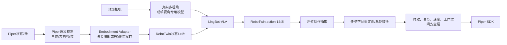

# RoboTwin 双臂三摄像头模型适配 Piper 单臂单顶部相机：后续工作路线

> 当前状态：输入、云端推理、动作返回和 SDK 执行链路已经跑通。  
> 当前不足：动作物理语义、机器人运动学、夹爪、视角和控制时序尚未完成可靠适配，因此还不能把“机械臂发生运动”视为“能够正常抓取”。

## 1. 当前差距

| 维度 | RoboTwin checkpoint | 当前 Piper | 直接兼容的风险 |
|---|---|---|---|
| 机器人 | 双臂 | 单臂 | 模型可能依赖双臂协同和另一只手的状态 |
| 手臂状态 | 12 维 | 6 维 | 关节顺序、方向、零位、工作空间不同 |
| 夹爪状态 | 2 维 | 1 维 | 开合范围、单位和方向不同 |
| 相机 | 顶部 + 左腕 + 右腕 | 单顶部相机 | 三路复制不能提供腕部近景和视差 |
| 动作 | RoboTwin embodiment | Piper SDK | 同维数也不代表同一物理动作 |
| 控制 | 训练环境固定频率 | 当前本地执行周期 | action chunk 的时间语义可能不一致 |
| 视觉域 | 仿真/训练场景 | 真实相机 | 光照、纹理、背景、畸变和物体分布不同 |
| 延迟 | 训练/评估环境 | 首次约 199 秒 | action chunk 在返回时可能已经过时 |

当前 `7→14→7` 只解决张量维度：

```text
Piper 7维
  → 填入 RoboTwin 左臂和左夹爪
  → 右臂和右夹爪使用中性占位
  → 模型输出 RoboTwin 14维
  → 抽取左臂6维和左夹爪1维
  → Piper 7维
```

它没有自动解决机械结构差异。尤其是直接使用 identity 映射：

```python
piper_arm_scale = np.ones(6)
piper_arm_bias = np.zeros(6)
```

只能用于结构测试，不应作为最终真机控制映射。

## 2. 推荐的目标架构



可靠抓取需要同时处理：

1. embodiment；
2. camera/view；
3. normalization；
4. action timing；
5. real-world domain；
6. safety and evaluation。

## 3. 两条可选路线

### 路线 A：尽量复用预训练模型，补齐硬件与适配层

适用条件：允许增加两个腕部相机，并能获得 RoboTwin 机器人和动作空间的完整定义。

工作内容：

- 增加真实左腕、右腕或等价视角相机；
- 完成三相机内参、外参、畸变和时间同步；
- 将 Piper 映射为模型左臂，右臂保持训练分布中的中性状态；
- 使用运动学重定向，而不是直接复制关节角；
- 对少量 Piper 数据做适配微调。

优点：最大程度保留模型训练时的输入结构。  
缺点：增加硬件和标定成本；Piper 与训练机器人形态仍不一致。

### 路线 B：固定单顶部相机，针对 Piper 做数据适配和微调

适用条件：硬件长期只有单臂和单顶部相机。

工作内容：

- 采集 Piper 单臂、单顶部相机示教数据；
- 训练时只启用 `cam_high`，或对腕部视角使用 view dropout/mask；
- 使用 Piper 专用 state/action schema 和 norm stats；
- 微调视觉输入层、action head 或完整 VLA；
- 保留预训练语言和视觉能力，同时让动作头学习 Piper embodiment。

优点：最终部署结构与训练结构一致，更适合长期使用。  
缺点：需要数据和训练资源。

如果目标是“可靠抓取”，路线 B 通常更符合当前固定硬件；三路镜像只应作为短期协议验证。

## 4. 分阶段工作计划

## 阶段 0：冻结当前可运行基线

目标：保证后续修改后能判断是进步还是回归。

需要保存：

- 当前本地和云端代码版本；
- checkpoint 路径和哈希；
- `piper.yaml`、norm stats 路径；
- 一份成功 reset 日志；
- 一份成功 observation 和 MessagePack；
- 一份模型原始 `(50,14)` 输出；
- 一份适配后 `(50,7)` 输出；
- 相机帧、Piper 状态、task、推理耗时；
- `execute=False` 时的安全过滤结果。

验收标准：同一静态输入可重复得到可解析的 `(chunk,7)`，过程中无 schema、归一化或超时错误。

## 阶段 1：查清 checkpoint 的动作与状态语义

这是后续所有标定的前置条件。必须从 RoboTwin 数据代码、robot config 和环境执行代码确认：

- 14 维排列是否确实是：

  ```text
  [left_arm_6, right_arm_6, left_gripper_1, right_gripper_1]
  ```

- 关节顺序和每一维对应的物理关节；
- 关节单位是 rad、degree 还是归一化值；
- action 是绝对关节位置、关节增量、速度还是末端动作；
- `subtract_state` 的真实语义；
- action chunk 的训练控制频率；
- 夹爪开/合的数值、单位和方向；
- norm stats 使用的 min/max、quantile 或 mean/std；
- 右臂中性 pose 和右夹爪中性值。

交付物：`ROBOTWIN_ACTION_CONTRACT.md`，逐维记录 state/action 定义。任何一项不明确，都不进入真机完整 chunk 测试。

## 阶段 2：完成 Piper 关节和夹爪校准

### 2.1 建立 Piper 状态定义表

记录：

| 维度 | Piper 关节 | SDK 反馈单位 | 正方向 | 零位 | 安全范围 |
|---|---|---|---|---|---|
| 0 | j1 | rad | 待标定 | 待标定 | SDK/实测 |
| ... | ... | ... | ... | ... | ... |
| 6 | gripper | mm/其他 | 待标定 | 待标定 | SDK/实测 |

### 2.2 不要默认采用关节角 identity 映射

若训练机器人与 Piper 连杆长度、关节轴或零位不同，推荐使用任务空间重定向：

```text
RoboTwin 左臂动作
→ RoboTwin FK 得到末端目标或末端增量
→ 坐标系/工作空间尺度映射
→ Piper IK
→ Piper 关节目标
```

只有在两种机械臂运动学结构非常接近并经过验证时，才使用逐关节仿射映射：

```python
piper_joint = sign * robotwin_joint + offset
```

需要为 6 个关节分别标定 `sign` 和 `offset`，不要使用单个全局 scale/bias。

### 2.3 夹爪标定

至少采集：

- 完全张开反馈和命令；
- 完全闭合反馈和命令；
- 3～5 个中间位置；
- 有物体接触时的安全力矩或 effort。

建立：

```text
RoboTwin left_gripper value ↔ Piper gripper mm
```

必要时使用分段线性映射，不要仅使用 `1.0` scale。

验收标准：关闭模型，仅输入人工构造的小步动作，Piper 的关节方向、末端运动方向和夹爪开合全部符合预期。

## 阶段 3：解决单相机与三相机的差异

当前把顶部图像复制到三个字段：

```text
cam_high = top
cam_left_wrist = top
cam_right_wrist = top
```

这只能满足 schema，不能恢复模型训练时的多视角信息。模型可能把相同画面解释为三个不同机位，尤其会缺失接近目标和闭合夹爪时的局部视觉反馈。

### 方案 3A：增加真实腕部相机

需要完成：

- 每个相机内参和畸变标定；
- 相机到末端/基座的外参；
- 三路帧时间同步；
- 曝光、白平衡、分辨率和裁剪策略对齐；
- 明确左腕、右腕字段分别对应哪个实际机位。

对于单臂，可以将第二个腕部字段设置为训练分布认可的缺失视图标记，但必须通过训练代码确认，不应随意复制。

### 方案 3B：单视角微调（推荐用于固定硬件）

- 训练/微调时只保留顶部视角；
- 或训练时随机 mask 腕部视角，让模型学会缺失视角；
- 为缺失视图使用明确 mask/token，而不是相同图像；
- 使用真实 Piper 场景数据做视觉域适配。

验收标准：离线评估中，模型能从顶部视角稳定定位目标、接近、闭合和抬起；遮挡阶段不能完全依赖不存在的腕部视角。

## 阶段 4：处理 normalization

存在两种不同目的，不能混用：

### 零样本兼容实验

- 保留 RoboTwin 原始 14 维 norm stats；
- 先将 Piper 状态映射到 RoboTwin 模型空间；
- 模型输出在 RoboTwin 空间反归一化后，再映射到 Piper。

### Piper 微调/正式部署

- 用 Piper 示教数据重新统计 state/action；
- 生成 Piper 专用 norm stats；
- 统计维度、feature key、动作单位必须与训练配置一致；
- 记录样本数、分位数方法、异常值处理和版本。

不要从 12 维统计数组中机械地截取前 6 维，除非已经确认排列并且模型训练路径确实支持这种改动。

## 阶段 5：对齐 action chunk 的时间语义

当前模型一次输出 50 步，但需要确认训练频率。例如若训练为 20 Hz，则 50 步表示 2.5 秒；若本地每 0.5 秒执行一步，则相同 chunk 会被拉长到 25 秒，动作语义会完全改变。

需要确认并实现：

- 训练环境控制频率；
- 本地 Piper 实际命令频率；
- SDK 命令是阻塞还是非阻塞；
- 每步目标是否会等待到位；
- 是否执行完整 chunk，还是只执行前 `K` 步后重新观测；
- observation 到动作返回的时效。

建议正式闭环采用 receding horizon：

```text
采集 observation
→ 推理得到 50 步
→ 只执行前 K 步
→ 重新采集
→ 再推理
```

`K` 应根据推理延迟、控制频率和场景变化确定。不要在目标已移动或机械臂状态已明显变化后继续执行陈旧 chunk。

当前约 199 秒推理延迟无法支撑正常视觉闭环。需要：

- 关闭不必要 compile/autotune 做稳定基线；
- 预热模型后测量稳态延迟；
- 检查 GPU、dtype、attention backend；
- 评估更快 GPU、量化、较小模型或减少 denoise steps；
- 记录 p50、p95、最大推理耗时；
- 让超时和动作时效检查使用不同参数。

验收标准：动作到达时仍满足预设的状态变化和时间戳阈值，否则整段丢弃。

## 阶段 6：建立真机安全门槛

当前简单限幅需要扩展为至少：

- 关节位置上下限；
- 单步最大关节变化；
- 速度和加速度限制；
- 末端工作空间边界；
- 自碰撞、桌面和固定障碍物检查；
- action timestamp/最大允许时延；
- NaN、Inf、维度和跳变检查；
- 通信断开和推理超时 watchdog；
- 急停可达并经过实测；
- 抓取力和夹爪 effort 限制；
- 执行前后的反馈一致性检查。

建议的真机升级顺序：

1. `execute=False`，只打印原始和安全动作；
2. 机械臂远离桌面，只测试单关节小步；
3. 固定姿态下测试夹爪；
4. 执行单个 action row；
5. 执行 2～5 步小 chunk；
6. 无物体 approach 测试；
7. 软物体、低速抓取；
8. 完整任务。

每一级通过后才进入下一级。

## 阶段 7：采集 Piper 数据并微调

仅靠接口适配通常难以跨越仿真到真实、双臂到单臂、三视角到单视角的全部差异。建议采集：

- 成功抓取示教；
- 失败和恢复过程；
- 不同目标位置、尺度、颜色、材质；
- 不同背景和光照；
- 相机帧、关节、夹爪、末端 pose、时间戳、task；
- 实际发送给 SDK 的安全后动作；
- episode 成功标签和失败原因。

训练策略可按成本递增：

1. 只训练 action head；
2. 训练 embodiment adapter；
3. 对视觉输入做 LoRA/轻量微调；
4. 使用完整 Piper 数据微调 VLA；
5. 使用失败数据和人工纠正继续迭代。

数据划分必须按场景或 episode 划分，避免相邻帧泄漏到验证集。

## 阶段 8：建立量化评估

至少记录：

| 指标 | 说明 |
|---|---|
| reset 成功率 | 配置和服务稳定性 |
| 推理成功率 | 是否返回合法 action |
| 推理 p50/p95 | 闭环时效 |
| 安全过滤触发率 | 动作是否经常超限 |
| approach 成功率 | 能否到达目标附近 |
| close 成功率 | 是否在正确位置闭合 |
| lift 成功率 | 是否抬起并保持 |
| 完整抓取成功率 | 端到端任务结果 |
| 碰撞/急停次数 | 安全指标 |

测试集应覆盖未参与训练的物体位置、背景和光照。

## 5. 建议的代码拆分

### 云端新增

建议将临时写在 policy 中的映射拆出：

```text
deploy/piper_embodiment_adapter.py
```

至少包含：

```python
piper_state_to_robotwin(...)
robotwin_action_to_piper(...)
validate_robotwin_contract(...)
```

并把以下参数放入独立 YAML：

- 左/右臂索引；
- 右臂中性状态；
- 每关节 sign/offset；
- 夹爪映射；
- action absolute/delta；
- 模型控制频率。

不要把这些物理参数硬编码在 `lingbot_vla_v2_policy.py`。

### 本地继续完善

- [piper_observation.py](./piper_observation.py)：增加时间戳和相机/状态同步质量；
- [lingbo_action_adapter.py](./lingbo_action_adapter.py)：接入标定后的单位和动作语义；
- [piper_safety_filter.py](./piper_safety_filter.py)：增加速度、加速度、工作空间和时效检查；
- [static_grasp_executor.py](./static_grasp_executor.py)：增加反馈确认、chunk 截断和 watchdog；
- [config_piper.yaml](./config_piper.yaml)：保存控制频率、时效阈值和校准文件路径。

## 6. 优先级清单

建议严格按以下顺序推进：

1. 查清 RoboTwin 14 维 state/action 的逐维定义；
2. 确认 absolute/delta、单位和训练控制频率；
3. 标定 Piper 六关节方向、零位和夹爪；
4. 决定采用关节映射还是 FK/IK 任务空间重定向；
5. 将硬编码的 `7→14→7` 拆成有配置、有测试的 embodiment adapter；
6. 测量模型预热后的稳态推理延迟并优化；
7. 完善本地动作时效、速度、加速度和工作空间安全；
8. 在 `execute=False` 下做离线轨迹和 FK 可视化；
9. 单步、低速、空场地验证；
10. 选择增加真实腕部相机，或启动单顶部相机微调；
11. 采集 Piper 示教数据并生成专用 norm stats；
12. 微调并建立抓取成功率评估。

## 7. 最终验收标准

不能只使用“没有 traceback”或“机械臂动了”作为验收。建议正式抓取至少满足：

- 输入字段、颜色空间、状态和时间戳持续正确；
- reset、推理和返回稳定；
- 动作物理语义经过逐维验证；
- 模型频率与实际执行频率一致；
- 过期 action chunk 会被拒绝；
- 关节、速度、加速度、工作空间和夹爪全部受限；
- 相机输入与部署方案一致，不再依赖无验证的三路镜像；
- 多轮独立测试中抓取成功率达到项目要求；
- 失败时能够安全停止，不继续执行剩余 chunk。

达到这些条件后，才能把当前系统从“VLA 云端链路原型”升级为“可验证的 Piper 静态抓取系统”。
