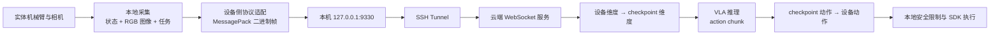

# 实体机械臂接入云端 VLA 推理：可复用排障与集成指南

> 状态快照：2026-08-25  
> 当前实例：PiPER-X 单臂 + 单顶部相机，接入 LingBot-VLA v2 RoboTwin checkpoint  
> 本文目标：沉淀一套可复用于其他机械臂、相机和 VLA 服务的接入方法。

## 1. 最终跑通的链路



当前已经验证：

- 本地能够采集 PiPER 关节、夹爪和顶部相机；
- observation 能通过 SSH 隧道和 WebSocket 发送到云端；
- reset、归一化配置和模型推理能够运行；
- 云端能够输出 `(50, 14)` 的 RoboTwin action chunk；
- 云端左臂适配器能够返回 `(50, 7)` 的 Piper action chunk；
- 本地能够接收动作，经过简单安全限制后调用 Piper SDK；
- 目前仅证明“输入—推理—返回—执行”的工程链路完整，不代表抓取动作已经正确标定。

## 2. 当前确认的协议

### 2.1 本地原始状态

```text
[j1, j2, j3, j4, j5, j6, gripper]
```

- 形状：`(7,)`
- 类型：`float32`
- 关节当前按弧度采集；
- 夹爪值必须单独确认其物理单位和正负方向。

### 2.2 云端 observation

本次 checkpoint 使用的是 RoboTwin 实际部署协议，不是旧示例中的 `image/state/prompt` 嵌套格式：

```python
observation = {
    "observation.images.cam_high": image_rgb_hwc,
    "observation.images.cam_left_wrist": image_rgb_hwc,
    "observation.images.cam_right_wrist": image_rgb_hwc,
    "observation.state": state_float32_1d,
    "task": "抓取桌面上的目标物体",
}
```

字段要求：

| 字段 | 类型与形状 | 说明 |
|---|---|---|
| `observation.images.cam_high` | `(H,W,3) uint8` | RGB 顶部视图 |
| `observation.images.cam_left_wrist` | `(H,W,3) uint8` | 左腕视图；当前临时复制顶部图像 |
| `observation.images.cam_right_wrist` | `(H,W,3) uint8` | 右腕视图；当前临时复制顶部图像 |
| `observation.state` | `(7,) float32` | Piper 原始状态，进入模型前由云端扩展 |
| `task` | `str` | 自然语言任务 |

OpenCV 输出默认是 BGR，发送前必须转换：

```python
image_rgb = cv2.cvtColor(frame_bgr, cv2.COLOR_BGR2RGB)
image_rgb = np.ascontiguousarray(image_rgb, dtype=np.uint8)
```

不要在本地提前转换成 `(1,3,H,W)`。当前服务端的 `FeatureTransform` 负责 resize、CHW 和 batch 处理。

### 2.3 reset

每次服务启动后、正式 observation 之前发送：

```python
{
    "reset": True,
    "robo_name": "piper",
    "path_to_pi_model": None,
}
```

成功响应：

```python
{
    "action": None,
    "reset_ok": True,
    "server_timing": {"infer_ms": ...},
}
```

`action: None` 是正常的：reset 只加载机器人配置和 FeatureTransform，不进行动作推理。

### 2.4 动作响应

正常响应至少包含：

```python
{
    "action": action_chunk,
    "server_timing": {...},
}
```

当前云端模型输出 `(50,14)`，经过 Piper 左臂适配后返回 `(50,7)`。

## 3. 最重要的经验：按层排障

不要同时修改网络、协议、模型配置和机械臂执行。应逐层建立可验证的通过条件。

### 第 1 层：模型能否独立启动

首先在云端确认 checkpoint、基础视觉语言模型路径、CUDA 和依赖正确。典型启动方式：

```bash
cd /app/u_1/emb/vla/lingbot_vla_v2_test/lingbot-vla-v2

CUDA_VISIBLE_DEVICES=1 \
PYTHONUNBUFFERED=1 \
python -u -m deploy.lingbot_vla_v2_policy \
  --model_path /app/u_1/emb/vla/lingbot_vla_v2_test/models/lingbot-vla-v2-6b-robotwin/checkpoints/global_step_50000/hf_ckpt \
  --port 9330 \
  --use_compile false
```

检查：

```bash
ss -lntp | grep ':9330'
```

必须看到 Python 服务监听 9330。若出现 `address already in use`，说明旧服务尚未停止；先确认 PID，再停止属于自己的旧进程。

### 第 2 层：SSH 隧道是否建立

本地：

```bash
ssh -N -L 9330:127.0.0.1:9330 用户名@云服务器IP
```

该命令成功后通常不会输出，也不会返回 shell，这不是卡死。另开终端检查：

```bash
ss -lntp | grep ':9330'
```

本地应看到 SSH 监听 `127.0.0.1:9330`，云端应看到 Python 服务监听 9330。

`nc -vz 127.0.0.1 9330` 只能验证 TCP；它不会发送 WebSocket HTTP 握手，因此云端出现 `opening handshake failed` 是预期现象，不能据此判断模型服务失败。

### 第 3 层：WebSocket 握手和 metadata

客户端连接后首先接收 metadata。收到：

```text
metadata: {}
```

即可证明：

- SSH 隧道通；
- WebSocket 握手通；
- 本地连接到了一个会发送 LingBot metadata 的服务。

它不能证明 observation schema、reset 或模型推理正确。

### 第 4 层：MessagePack 必须使用二进制帧

LingBot 的 MessagePack 数据必须通过 WebSocket binary frame 发送：

```python
ws.send_binary(Packer().pack(request))
```

不要使用：

```python
ws.send(Packer().pack(request))
```

后者可能将 bytes 当作文本帧处理，造成 UTF-8、空响应或直接断开。正式客户端已在 [cloud_protocol.py](./cloud_protocol.py) 中统一使用 binary frame。

### 第 5 层：让服务端异常可见

客户端曾经只收到 `''`，根因并不是网络，而是服务端将无文本异常转换成了空字符串。服务端 handler 至少应打印：

```python
except Exception as exc:
    print(f"[WS ERROR] {type(exc).__name__}: {exc!r}", flush=True)
    traceback.print_exc()
    await websocket.send(traceback.format_exc())
```

建议在调用 policy 前打印：

```python
print("[WS] request keys:", list(obs.keys()), flush=True)
```

这能快速区分：

- 请求根本没到 handler；
- MessagePack 解码失败；
- reset 失败；
- FeatureTransform 失败；
- 模型推理失败；
- 返回序列化失败。

### 第 6 层：先单独验证 reset

reset 成功日志应包括：

```text
[INFER] reset request received
[RESET] loading: .../configs/robot_configs/piper.yaml
[RESET] success; org_features: ...
```

本次依次遇到：

1. `KeyError('norm_stats')`：robot config 缺少顶层 `norm_stats`；
2. `JSONDecodeError`：配置指向空文件、非 JSON 或错误文件；
3. `norm_stats_file: null`：训练 YAML 没提供默认文件，仍需找到 checkpoint 对应的有效统计文件；
4. 找到合法统计文件后 reset 成功。

经验：

- `config.json`、tokenizer JSON、safetensors 索引都不是 norm stats；
- 使用 `python -m json.tool 文件路径` 验证 JSON；
- 不要用空 JSON 或随意伪造统计数据让 reset 表面通过；
- `norm_stats` 的特征名、维度和模型动作空间必须一致。

### 第 7 层：从真实训练代码确定输入，不依赖 dummy 示例

旧测试客户端使用过：

```python
{"image": {...}, "state": ..., "prompt": ...}
```

但 RoboTwin 的实际成功路径使用扁平字段。判断 checkpoint 接口的优先级应为：

1. 当前 checkpoint 的实际评估/部署代码；
2. 当前 `robot_config` 和 `FeatureTransform.org_features`；
3. 训练数据字段定义；
4. README；
5. dummy 或历史示例。

不要仅根据能运行的示例推断当前 checkpoint 的 schema。

### 第 8 层：observation 验证器必须与真实 schema 一致

早期 `inspect_observation()` 仍检查 `observation["image"]`，因而错误拦截了正确的扁平输入。验证器应检查：

```text
三张 HWC uint8 RGB 图像
一个 (7,) float32 状态
一个非空 task 字符串
```

看到：

```text
[OBS] validation success
```

只表示传输后的数据结构正确，还没有证明归一化和模型动作空间兼容。

### 第 9 层：区分设备维度与 checkpoint 维度

本次归一化报错：

```text
operands could not be broadcast together with shapes (6,) (12,)
```

含义是：Piper 手臂 6 维，而 checkpoint 的手臂统计是双臂 12 维。不能简单裁剪 norm stats；正确做法是保留 checkpoint 的双臂空间，并加入 embodiment adapter：

```text
Piper 7维
  → 左臂填充 + 右臂中性占位
RoboTwin 14维
  → VLA
RoboTwin action 14维
  → 抽取左臂6维 + 左夹爪1维
Piper action 7维
```

本次日志证明维度转换已经运行：

```text
[PIPER ADAPTER] state: (7,) -> (14,)
[PIPER ADAPTER] action: (50, 14) -> (50, 7)
```

注意：这只是维度兼容，不代表关节顺序、方向、零位、尺度和运动学已经正确。

### 第 10 层：推理超时要覆盖真实最坏耗时

本次云端首次推理耗时：

```text
sample_actions batch=1 cost 199.206 s
```

本地默认超时为 120 秒，因此本地先断开，云端随后才生成动作。解决办法是将接收超时提高至 600 秒：

```yaml
receive_timeout_s: 600.0
```

`Not enough SMs to use max_autotune_gemm mode` 是 PyTorch 性能警告，不是数据错误。调试阶段可使用 `--use_compile false`，并用 `nvidia-smi` 确认进程、显存和利用率。

### 第 11 层：最后才允许 SDK 执行

推荐通过顺序：

```text
采集并打印 observation
→ 保存并离线解包 MessagePack
→ reset
→ 云端 dry-run 推理
→ 检查 action shape/dtype/range
→ 本地安全过滤但 execute=False
→ 单关节/单步低速测试
→ 小 chunk 测试
→ 完整 chunk
```

不要因为 action 最后一维是 7 就直接执行。维度正确不代表物理语义正确。

## 4. 本次问题与解决方案速查表

| 现象 | 根因 | 解决方案 | 通过证据 |
|---|---|---|---|
| `Connection refused` | `127.0.0.1:8000` 没有服务，或接口/端口是假设值 | 使用实际 WebSocket 端口并启动云端服务/隧道 | metadata 可接收 |
| SSH `-N -L` 无输出 | 正常前台保持隧道 | 另开终端检查监听 | 本地 9330 属于 ssh |
| 云端 `nc` 后握手失败 | TCP 探测不是 WebSocket | 用真实 WebSocket 客户端验证 | metadata `{}` |
| `b'\x80'`、空文本或断开 | schema 错误、服务端吞异常或二进制数据发成文本帧 | binary frame + 完整 traceback | 服务端打印 request keys |
| 服务端没有请求日志 | 看错进程/日志、旧进程未重启、handler 未打印 | 查 PID、cwd、cmdline，重启正确模块 | 新 handler 日志出现 |
| `KeyError('norm_stats')` | robot YAML 缺少必需键 | 增加有效 norm stats 路径 | reset 继续进入 normalizer |
| `JSONDecodeError` | norm stats 为空、非 JSON、LFS 指针或路径错误 | 检查大小、文件头、`json.tool` | JSON 可正常加载 |
| `missing 'image'` | 调试器仍按旧 schema 检查 | 更新 `inspect_observation()` 为扁平字段 | `[OBS] validation success` |
| `(6,)` 与 `(12,)` 广播失败 | 单臂状态与双臂 checkpoint 统计维度冲突 | 云端 `7→14→7` embodiment adapter | 进入 `sample_actions` |
| NumPy non-writable warning | MessagePack 解包数组只读 | 转 tensor 前 `np.array(..., copy=True)` | 警告消失 |
| 本地 120 秒超时，云端 199 秒成功 | 接收超时小于推理时间 | 超时改为 600 秒并优化推理 | 本地收到 `(50,7)` |
| 端口 `address already in use` | 旧服务仍监听 9330 | 确认 PID 后停止旧服务 | 新进程成功监听 |

## 5. 其他设备接入时的交付清单

每接入一种新机械臂，至少准备以下内容：

### 设备侧

- 状态向量定义：顺序、单位、范围、参考零位；
- 夹爪定义：位置/开合量、单位、方向；
- 相机：数量、字段名、RGB/BGR、分辨率、时间戳；
- VLA 请求构造器；
- WebSocket binary MessagePack 客户端；
- action 解析器；
- 关节、速度、加速度、工作空间和时效安全限制；
- SDK 执行器和急停流程。

### 云端

- checkpoint 和基础模型路径；
- 与 checkpoint 一致的 robot config；
- 合法且维度一致的 norm stats；
- 设备空间到 checkpoint 空间的输入适配；
- checkpoint 动作到设备动作的输出适配；
- reset；
- observation 日志和完整 traceback；
- 推理耗时、输入形状、输出形状日志。

### 必须记录的接口表

| 项目 | 必须明确 |
|---|---|
| state | 每一维的语义、单位、范围、顺序 |
| action | absolute/delta、关节/末端、单位、频率 |
| image | 视角、颜色空间、HWC/CHW、同步方式 |
| normalization | 统计文件、特征键、每个数组维度 |
| chunk | 长度、采样周期、是否允许提前终止 |
| reset | 何时调用、加载什么配置、返回值 |
| timeout | 首次和稳态推理耗时 |

## 6. 当前仓库中的对应文件

- [client.py](./client.py)：采集、reset、请求、接收、调度；
- [cloud_protocol.py](./cloud_protocol.py)：MessagePack、binary frame、schema 和响应解析；
- [piper_observation.py](./piper_observation.py)：Piper 和相机采集；
- [lingbo_action_adapter.py](./lingbo_action_adapter.py)：本地动作语义与单位适配；
- [piper_safety_filter.py](./piper_safety_filter.py)：本地安全限幅；
- [static_grasp_executor.py](./static_grasp_executor.py)：action chunk 的 SDK 执行；
- [config_piper.yaml](./config_piper.yaml)：客户端超时、频率、单位和限幅；
- [robot_config_piper.yaml](./robot_config_piper.yaml)：云端 FeatureTransform 配置模板。

## 7. 当前结论与边界

已经完成的是工程连通性：

```text
采集 → 编码 → 隧道 → reset → 预处理 → 推理
→ 14维动作 → 7维动作 → 安全过滤 → SDK
```

尚未完成的是任务正确性：

- 单顶部相机复制成三路不具备真实腕部视角；
- Piper 与 RoboTwin 左臂的运动学和关节语义未标定；
- 夹爪映射未标定；
- action absolute/delta、执行周期和训练控制频率仍需严格核验；
- 199 秒推理延迟不适合直接闭环抓取；
- 预训练模型存在视觉域、机器人形态域和任务域差异。

因此，链路跑通应作为“集成阶段完成”，不能作为“抓取能力完成”的验收标准。后续任务见 [PIPER_ROBOTWIN_ADAPTATION_ROADMAP.md](./PIPER_ROBOTWIN_ADAPTATION_ROADMAP.md)。
