# Piper Project 主要开发流程梳理

> 梳理日期：2026-08-10  
> 梳理依据：当前仓库源码、README、架构文档、Web 指挥中心现场命令和近期 Git 提交。  
> 核心范围：Windows Vision → Information Transportation → Linux Catch，以及支撑该主链路的必要子流程。

## 1. 结论先行

当前项目已经形成一条可运行的跨 Windows/Linux 视觉抓取闭环：

```text
Windows RealSense 采集与目标识别
  -> RGB/Depth 对齐与三维定位
  -> 生成静态或动态抓取命令
  -> TCP + JSON Lines 发送
  -> Linux 接收、校验与 camera -> base 映射
  -> 动态时序、抓取姿态和路径规划
  -> Piper SDK + CAN 控制机械臂与夹爪
  -> ACK/error 返回 Windows
```

从仓库和 `web_command_center/state/commands.json` 看，当前现场主链路是：

```text
robot_control.windows.client.opencv_grasp_send_tcp dynamic
  -> robot_control.shared.protocol
  -> robot_control.linux.catch.catch_server_1
  -> robot_control.linux.arm.piper_arm.PiperController
  -> Piper SDK / can0 / 机械臂 / 夹爪
```

项目中还存在三类并行或演进链路：

| 链路 | 定位 | 当前状态判断 |
| --- | --- | --- |
| `yolo_grasp_send_tcp` / `yolo_seg_grasp_send_tcp` → `catch_server_1` | YOLO bbox 或实例分割替换 OpenCV 检测，后半段复用主流程 | 已实现，可用于替换视觉前端 |
| `opencv/yolo...` → `catch_server_1_1` | 笛卡尔 waypoint、多起点 IK、物体姿态优化的新版抓取服务 | 近期重点开发分支，但当前 Web 现场命令尚未切换到它 |
| `graspnet_grasp_send_tcp` → `catch_server_graspnet` | 发送多组 6D 抓取候选，由 Linux 做完整 6 轴 IK 与安全筛选 | 独立实验/高级链路，不应发给 `catch_server_1` |
| 普通视觉客户端 → `catch_server_2` | eye-in-hand 静态抓取，每次按当前末端位姿计算 camera → base | 已实现的另一种相机安装方案，不是当前传送带主流程 |

因此，后续开发时需要明确区分：

1. **现场稳定主线**：`opencv_grasp_send_tcp dynamic` + `catch_server_1`。
2. **同协议视觉替换**：YOLO bbox / YOLO segmentation。
3. **抓取执行层升级候选**：`catch_server_1_1`。
4. **6D 抓取独立链路**：GraspNet client + GraspNet server。

## 2. 工程分层与职责

| 层级 | 主要目录/文件 | 核心职责 |
| --- | --- | --- |
| Windows 视觉采集层 | `robot_control/windows/vision/` | RealSense RGB/Depth 对齐、深度读取、像素反投影、OpenCV/YOLO 检测、传送带深度平面 |
| Windows 视觉业务层 | `robot_control/windows/client/` | 目标筛选、抓取点生成、动态到达时间计算、命令封装和 TCP 发送 |
| 跨平台协议层 | `robot_control/shared/protocol.py` | `CameraPointCommand`、JSON Lines 编解码、短连接请求及 ACK/error |
| Linux 坐标与规划层 | `robot_control/linux/catch/` | 手眼映射、目标约束、动态时序、抓取/放置动作序列、IK 与执行反馈 |
| Linux 设备控制层 | `robot_control/linux/arm/`、`robot_control/linux/gripper/` | Piper SDK、CAN、关节/末端运动、状态读取、夹爪控制和安全检查 |
| 标定层 | `robot_control/linux/hand_eye/`、`robot_control/windows/hand_eye/`、`robot_control/linux/tcp_calibration/` | camera/base 外参、eye-in-hand 外参、J6 到夹爪 TCP 偏移 |
| 运维与可视化层 | `web_command_center/` | 启停 Windows/Linux 命令、OpenCV 预览、日志查看 |
| 模型与标定资产 | `models/` | YOLO/GraspNet 权重、GraspNet 后端、传送带深度平面等 |

## 3. 主流程总览

```mermaid
flowchart LR
    A["RealSense D435i"] --> B["Windows RGB/Depth 对齐"]
    B --> C["OpenCV / YOLO / YOLO-seg / GraspNet"]
    C --> D["像素抓取点与深度统计"]
    D --> E["像素反投影为 camera XYZ"]
    E --> F["静态选择或动态候选调度"]
    F --> G["CameraPointCommand"]
    G --> H["TCP + JSON Lines"]
    H --> I["Linux catch server"]
    I --> J["协议校验与 camera -> base"]
    J --> K["目标约束、动态时序与路径规划"]
    K --> L["dry-run / probe / 安全检查"]
    L --> M["PiperController"]
    M --> N["Piper SDK + CAN"]
    N --> O["机械臂与夹爪"]
    O --> P["ACK / error / 执行详情"]
    P --> F
```



### 3.1 主流程的数据所有权

主流程中两端的职责边界应保持清晰：

- Windows 负责回答“看到了什么、目标在相机坐标系哪里、何时到达抓取线”。
- 协议层负责回答“跨平台传哪些标准字段、如何关联请求与响应”。
- Linux 负责回答“机器人是否能抓、最终抓取点和姿态是什么、路径如何执行”。
- 机械臂控制层负责回答“命令是否真正下发、反馈是否到位、是否触发安全限制”。

Linux 应始终保留对视觉结果的最终校验权，不能仅因为 Windows 发来了坐标就直接驱动实机。

## 4. Windows Vision 开发流程

### 4.1 相机初始化与帧对齐

主要代码：

- `robot_control/windows/vision/depth.py`
- `robot_control/windows/vision/d435i_intrinsics.py`

处理顺序：

1. 创建 RealSense color/depth pipeline。
2. 以 color stream 为基准对齐 depth。
3. 获取 RGB 图像和已对齐的 depth frame。
4. 按当前分辨率读取 RealSense 实时内参或 `d435i_para.json` 中的 rectified 内参。
5. 对无效、超范围或邻域有效像素不足的深度点直接拒绝。

这里最重要的约束是：**相机分辨率、内参 profile、手眼标定采集分辨率和传送带深度平面分辨率必须一致**。

### 4.2 目标识别

当前支持四种视觉策略：

| 客户端 | 目标生成方式 | 适用场景 |
| --- | --- | --- |
| `opencv_grasp_send_tcp.py` | 传送带颜色分离、轮廓/mask、质心、顶部深度、短轴方向 | 当前现场主线，规则明确、推理延迟低 |
| `yolo_grasp_send_tcp.py` | YOLO bbox 中心加偏移，结合局部深度 | 通用物体检测、按类别/置信度筛选 |
| `yolo_seg_grasp_send_tcp.py` | 实例 mask 质心/顶部点和 mask 深度统计 | 物体轮廓不规则、bbox 中心不可靠时 |
| `graspnet_grasp_send_tcp.py` | 点云推理得到多组 6D grasp candidates | 需要完整位置和旋转姿态的高级抓取 |

当前 Web 配置实际使用 OpenCV 动态模式，包含：

- 传送带 HSV 范围和高光剔除；
- ROI 与入场边缘判定；
- mask 形态学开闭操作；
- 目标面积和宽高阈值；
- mask 质心/短轴方向；
- 动态候选窗口和重复目标抑制。

### 4.3 从二维目标到 camera XYZ

普通抓取点生成过程为：

```text
检测结果 bbox/mask
  -> 选择像素点 (u, v)
  -> 读取局部深度或 mask 深度中值
  -> RealSense deproject
  -> camera XYZ（单位 m）
```

OpenCV/segmentation 路径还会保留目标 mask 顶部点、顶部深度和物体短轴角度，供 Linux 决定抓取 Z 和夹爪 yaw。

如果启用传送带深度平面，则先用空传送带平面估计局部带面深度，再从目标 mask 中估计物体顶部，可减少传送带倾斜对 Z 的影响。

### 4.4 静态与动态目标调度

静态模式：

- 按深度或配置规则列出候选；
- 操作员输入 `out 1`、`in 2` 等命令选择目标；
- Linux 使用 camera → base 映射后的 X/Y 作为抓取点。

动态模式：

1. Windows 使用同一份 eye-to-hand 结果先把 camera XYZ 映射到 base XYZ。
2. 检查目标是否进入动态有效窗口。
3. 根据传送带方向、速度和固定抓取线计算剩余距离。
4. 计算：

   ```text
   t_arrive_s = remaining_y_mm / conveyor_speed_mm_s
   ```

5. 按预计到达时间排序，选取最早可抓目标。
6. 对已发送、过近、被服务端跳过的目标做短期空间记忆，避免重复发送。
7. 将 `pick_x_mm`、`pick_y_mm`、`t_arrive_s` 和检测元数据一起发送给 Linux。

这意味着动态链路中，Windows 和 Linux 必须加载**同一份** `camera -> base` 手眼矩阵；否则 Windows 估计的到达时间与 Linux 最终映射位置会不一致。

### 4.5 Windows 阶段输出

Windows 最终构造 `CameraPointCommand`。主要字段包括：

| 字段组 | 代表字段 | 用途 |
| --- | --- | --- |
| 相机三维点 | `x_m/y_m/z_m` | Linux 重新做 camera → base 映射的原始输入 |
| 像素/深度 | `u/v/depth_m` | 现场复核与问题定位 |
| 请求关联 | `command_id` | 对应 ACK/error |
| 任务 | `task=out/in` | 决定抓出还是抓回动作序列 |
| 检测元数据 | `label/confidence/class_id/bbox_xywh` | 筛选、日志和回放 |
| 抓取模式 | `static/dynamic/probe` | 决定 Linux 时序和是否执行 |
| 动态信息 | `t_arrive_s/conveyor_speed_mm_s/pick_x_mm/pick_y_mm` | 传送带定时抓取 |
| 三维辅助点 | `detected_*`、`detected_top_*` | 动态位置和抓取高度 |
| mask/方向 | `mask_*`、`object_short_axis_yaw_deg` | 稳定深度和夹爪旋转 |
| 6D 候选 | `grasp_candidates` | 仅供 GraspNet 独立服务使用 |

## 5. Information Transportation 开发流程

### 5.1 协议形式

主要代码：`robot_control/shared/protocol.py`。

- 传输层：TCP；
- 应用层格式：一行一个 UTF-8 JSON，即 JSON Lines；
- 当前协议版本：`PROTOCOL_VERSION = 1`；
- 消息类型：`camera_point`、`ack`、`error`；
- 每条请求包含 `command_id`；
- 当前 Windows 公共发送函数通常为一次请求建立一个 TCP 连接，发送一行并等待一条响应。

请求结构概念如下：

```json
{
  "type": "camera_point",
  "version": 1,
  "command_id": "...",
  "payload": {
    "x_m": 0.1,
    "y_m": 0.2,
    "z_m": 0.5,
    "task": "out",
    "grasp_mode": "dynamic"
  }
}
```

### 5.2 传输处理顺序

```text
Windows 生成 CameraPointCommand
  -> make_camera_point_message()
  -> JSON 编码并追加换行
  -> connect(host, port)
  -> sendall()
  -> Linux recv_json_line()
  -> 解析/规划/执行
  -> ACK 或 error
  -> Windows 更新候选状态、打印结果或决定是否继续
```

### 5.3 ACK/error 的作用

Linux ACK 不只是“收到”，还会返回：

- `executed`：是否真的执行；
- `skipped`：是否因为动态目标过近等原因跳过；
- camera → base 结果；
- 最终 `pick_x_mm/pick_y_mm/grasp_z_mm` 及其来源；
- 动作 `steps`；
- 动态时序与预定位结果；
- planar IK、pitch、yaw 调整结果；
- 夹爪力矩保护结果；
- 每个阶段的命令发送次数。

Windows 应将 ACK 当作闭环状态，而不是只检查 socket 是否成功。只有 ACK 表示 `executed=true`，才能认为本次实机任务已经执行。

### 5.4 当前传输层边界

当前协议适合单机联调和串行抓取，但还不具备完整生产调度能力：

- 没有持久任务队列；
- 没有跨重启任务恢复；
- 没有完善的目标 tracking ID 生命周期；
- 没有多目标并发、取消和优先级协议；
- TCP 连接成功不等于机械臂动作成功，必须解析 ACK/error；
- Windows/Linux 时钟、视觉耗时和网络延迟没有统一时间戳补偿。

## 6. Linux Catch 开发流程

### 6.1 服务启动

当前主服务：`robot_control/linux/catch/catch_server_1.py`。

服务启动时主要完成：

1. 解析 host、port、CAN、手眼文件、抓取姿态、速度、安全阈值等参数。
2. 加载 eye-to-hand `camera -> base` 矩阵并打印标定质量摘要。
3. 创建仅用于边界/姿态校验的 controller/validator。
4. `--execute` 模式下连接 Piper SDK、CAN 和夹爪。
5. 可选移动到 ready 位姿并预打开夹爪。
6. 监听 TCP 请求。

默认不加 `--execute` 时只规划、校验和返回 ACK，不驱动真实机械臂。这是主流程必须保留的安全门。

### 6.2 单条消息处理

```text
recv_json_line
  -> camera_point_from_message
  -> probe / static / dynamic 分流
  -> camera XYZ 映射为 base XYZ
  -> 解析或覆盖最终 pick X/Y/Z
  -> 目标边界检查
  -> 动态时序检查
  -> 构造 out/in 动作序列
  -> waypoint 与 IK/关节限制校验
  -> dry-run 或实机执行
  -> 生成 ACK/error
```

Linux 会重新加载手眼矩阵并映射原始 camera XYZ。动态模式下，最终 X/Y 可优先使用 Windows 发来的固定抓取线坐标，但映射结果仍会保留在 ACK 中用于核对。

### 6.3 动态时序

Linux 计算：

```text
t_wait_s = t_arrive_s - action_time_s
```

其中 `action_time_s` 根据配置可能来自：

- 普通模式下的 `t_robot_s`；
- 动态预定位模式下的 `final_action_time_s`；
- `dynamic-wait-placement=nowait` 时按当前实现重新使用 `t_robot_s`。

如果 `t_wait_s < 0` 且开启过近跳过，服务端返回 `skipped=true`，不盲目追赶已经错过的包裹。

动态预定位的思想是：先到 ready、目标上方或较高的等待位，再等待最后下降和闭合窗口，以缩短最后动作时间。

### 6.4 抓取目标生成

目标生成包含多层来源选择：

- 静态模式 X/Y：使用 camera → base 映射结果；
- 动态模式 X/Y：使用 Windows 发送的 `pick_x_mm/pick_y_mm`；
- `--force-pick-x-mm/--force-pick-y-mm`：现场强制固定抓取线；
- Z：固定 `--grasp-z`，或使用检测中心/顶部 Z 加偏移；
- 固定抓取 Z 同时可作为最低安全地板；
- planar IK 可对 X、pitch 和 Z 做补偿；
- 物体短轴角度可用于抓取 yaw 调整。

### 6.5 动作序列

`task=out` 默认用于从传送带抓取并放到固定分拣点：

```text
ready_open
  -> pick_above
  -> pick_grasp + close
  -> pick_lift
  -> [return_ready_above]
  -> place_above
  -> place_release + open
  -> return_ready
```

`task=in` 默认用于从指定点抓回 ready 位置：

```text
ready_open
  -> return_pick_above
  -> return_pick_grasp + close
  -> return_pick_lift
  -> return_ready_above
  -> final_release + open
```

### 6.6 机械臂与夹爪执行

主要代码：

- `robot_control/linux/arm/piper_arm.py`
- `robot_control/linux/arm/kinematics.py`
- `robot_control/linux/arm/safety.py`
- `robot_control/linux/gripper/`

执行层负责：

- Piper SDK 连接和使能；
- CAN 接口选择；
- 位姿/关节命令下发；
- waypoint 到位等待和反馈误差检查；
- 正运动学与 IK 辅助；
- 关节、位置、姿态和工作空间限制；
- 夹爪预打开、闭合、释放；
- 夹爪反馈力矩监控和过载保护；
- 中断或异常时尽可能保持当前位置。

## 7. 主流程以外的必要子流程

以下流程不是每次抓取都执行，但它们是主流程能正确工作的前置条件或长期保障。

| 子流程 | 必要性 | 主要输入 | 主要输出 | 何时重做 |
| --- | --- | --- | --- | --- |
| 环境与依赖部署 | 必须 | Python、RealSense、Piper SDK、模型 | Windows/Linux 可运行环境 | 换机器、升级依赖、重新发布 |
| CAN/机械臂连通性 | 必须 | `can0`、SDK、机械臂 | 可读取状态并安全使能 | Linux/硬件/线缆变化 |
| RealSense 与内参校验 | 必须 | 相机、分辨率、内参 JSON | 正确的像素反投影 | 相机/分辨率/内参变化 |
| eye-to-hand 手眼标定 | 当前主线必须 | 棋盘格相机位姿 + 末端位姿 | `camera -> base` | 相机、机械臂底座、安装结构变化 |
| 手眼标定验证 | 必须 | 已知 base 点 | 映射误差报告 | 每次标定后、现场搬动后 |
| 传送带深度平面标定 | 建议启用 | 空传送带 ROI 深度点 | `belt_depth_plane*.json` | 相机、传送带平面、分辨率变化 |
| 夹爪零点与量程校准 | 实机必须 | 完全张开位置、实际宽度 | 零点/宽度/命令关系 | 夹爪装配、传动、固件变化 |
| J6 → gripper TCP 标定 | 高精度/6D 抓取必须 | 固定点 pivot 多姿态样本 | TCP 平移偏移 | 夹爪或工具安装变化 |
| 传送带速度/方向标定 | 动态抓取必须 | 速度、方向、抓取线 | `t_arrive_s` 模型 | 传送带速度或机械结构变化 |
| 机器人动作耗时标定 | 动态抓取必须 | X 区间和实测动作耗时 | `t_robot_s` 分段模型 | 速度、路径、姿态、负载变化 |
| 工作空间和安全边界配置 | 实机必须 | 现场几何和限位 | X/Y/Z/关节/高度阈值 | 工位、料框、相机或机械臂移动 |
| 固定轨迹/无视觉链路验证 | 强烈建议 | 已知安全点 | 机械臂和夹爪基础闭环 | 每次大改执行层后 |
| probe/dry-run 联调 | 强烈建议 | 视觉目标 | 映射、路径和 ACK 验证 | 每次改视觉/标定/规划参数后 |
| Web 指挥中心与日志 | 运维必要 | Windows/Linux 命令 | 启停、预览和日志 | 部署或命令参数变化 |
| 单元测试与回归测试 | 开发必须 | fake SDK/协议数据 | 自动回归结果 | 每次代码提交 |
| eye-in-hand 标定 | 特定方案必需 | 固定棋盘格 + 移动相机 | `gripper -> camera` | 使用末端相机方案时 |
| GraspNet 后端/TCP 轴系标定 | 6D 抓取必需 | 点云后端、approach 轴、TCP 旋转偏移 | 可行 6D 抓取候选与 IK | 启用或重装 GraspNet/工具时 |

## 8. 关键子流程详解

### 8.1 eye-to-hand 手眼标定

当前传送带主线是固定相机，因此使用 `eye_to_hand`：

```text
Linux 移动机械臂上的棋盘格
  -> Windows 检测棋盘格
  -> solvePnP 得到 target -> camera
  -> Windows 发给 Linux 采样服务
  -> Linux 同步读取 base -> gripper
  -> 保存 20-30 组多姿态样本
  -> OpenCV calibrateHandEye
  -> 输出 camera -> base
  -> 点击已知点验证映射误差
```

主要入口：

```bash
# Linux 采样服务
python3 -m robot_control.linux.hand_eye.collect_server \
  --host 0.0.0.0 --port 5010 --can can0 \
  --mode eye_to_hand --overwrite

# Windows 人工采样
python -m robot_control.windows.hand_eye.capture_chessboard \
  --host <linux-ip> --port 5010 \
  --corners-rows 8 --corners-cols 11 --checker-size-mm 15

# Linux 求解
python3 -m robot_control.linux.hand_eye.solve_hand_eye \
  --samples robot_control/linux/hand_eye/hand_eye_samples.json \
  --output robot_control/linux/hand_eye/hand_eye_result.json \
  --mode eye_to_hand --method tsai
```

仓库当前有两份 eye-to-hand 结果：

| 文件 | 样本数 | 平移 RMS | 旋转 RMS | 当前用途 |
| --- | ---: | ---: | ---: | --- |
| `hand_eye_result.json` | 20 | 约 19.60 mm | 约 2.84° | `catch_server_1` 代码默认值和旧 README 示例 |
| `eye_to_hand_result_auto.json` | 25 | 约 9.62 mm | 约 1.89° | 当前 Web Windows/Linux 现场命令实际使用 |

自动结果质量更好，且现场两端已统一使用它。建议后续把“当前生产手眼文件”收敛为单一明确配置，避免代码默认值、README 和 Web 命令指向不同文件。

### 8.2 传送带深度平面标定

入口：`robot_control/windows/client/calibrate_belt_depth_plane.py`。

```text
空传送带
  -> 在 ROI 内自动网格或人工采样深度
  -> 拟合 z = a*u + b*v + c
  -> 保存平面系数、分辨率、ROI 和残差
  -> Windows 视觉客户端加载
  -> 从目标深度中消除带面倾斜影响
```

当前 `models/calibration/belt_depth_plane_1280x720.json` 已有 18 个样本，RMS 约 1.65 mm，质量可用于现场验证。但当前 `web_command_center/state/commands.json` 的 Windows 命令没有传 `--belt-depth-plane-json`，因此该标定能力当前没有真正接入现场主命令。

### 8.3 J6 到夹爪 TCP 标定

入口：`robot_control/linux/tcp_calibration/`。

```text
让真实 TCP 尖端始终对准同一个固定点
  -> 改变多个 J6 姿态并记录反馈
  -> fixed-point pivot 求解 J6 -> TCP 平移
  -> 独立样本验证固定点误差
  -> 将结果用于 J6/TCP 位姿互算和 6D IK
```

```bash
python3 -m robot_control.linux.tcp_calibration.collect_tcp_data --can can0 --overwrite
python3 -m robot_control.linux.tcp_calibration.solve_tcp
python3 -m robot_control.linux.tcp_calibration.validate_tcp --collect --can can0 --overwrite
```

当前 `robot_control/linux/tcp_calibration/tcp.yaml` 状态仍为 `uncalibrated`，XYZ 全为 `null`。这对依赖准确工具中心点的 GraspNet 6D 抓取和姿态变化抓取是明显风险。当前部分运行参数使用命令行 `fk-tool-z-offset` 或 `tcp-offset-*` 补偿，但它们尚未与 `tcp.yaml` 形成明确的单一配置来源。

### 8.4 夹爪零点与量程

建议顺序：

1. 机械确认夹爪无卡滞。
2. 读取状态并诊断 J6/夹爪 CAN 反馈。
3. 在物理完全张开位置设置零点。
4. 小力矩测试打开/闭合命令。
5. 记录命令值、反馈位置、真实开口宽度和力矩。
6. 再接入自动抓取。

常用入口：

```bash
python3 -m robot_control.linux.gripper.gripper_debug status --can can0 --enable --pretty
python3 -m robot_control.linux.gripper.diagnose_j6_gripper --can can0
python3 -m robot_control.linux.catch.set_gripper_zero --can can0 --yes --verify
```

当前 `robot_control/linux/gripper/gripper_config.yaml` 中反馈位置和量程均为 0，实际宽度也是 `null`，更像未完成的占位标定数据；现场命令则直接使用 `open-command-mm=0`、`grasp-command-mm=-90`。应避免误以为该 YAML 已经是有效量程配置。

### 8.5 传送带与机器人耗时标定

动态抓取不仅依赖空间标定，还依赖时间标定：

```text
目标检测延迟
+ Windows 处理延迟
+ TCP 往返延迟
+ Linux 规划延迟
+ 机械臂预定位/下降时间
+ 夹爪闭合时间
= 实际抓取时刻误差
```

当前传送带速度主要由人工参数输入，机器人耗时由 `t_robot_s` 及按 X 分段斜率经验建模。任何下列变化都需要重新测量：

- 机械臂 speed/startup-speed；
- 抓取点 X 区间；
- planar IK 或 yaw 动作策略；
- transfer/vertical mode；
- 夹爪 settle time；
- 包裹重量；
- 传送带速度；
- Windows 模型或图像分辨率。

### 8.6 probe、dry-run 与固定动作验证

推荐验证层级：

1. `probe`：只做 camera → base 映射，不生成实机动作。
2. server 不加 `--execute`：生成完整计划、边界检查和 ACK。
3. `--no-gripper`：只验证机械臂路径。
4. 低速、空场景、固定安全点实机动作。
5. 静态目标抓取。
6. 低速传送带动态抓取。
7. 连续多目标运行。

不要从视觉参数修改直接跳到高速动态实机抓取。

## 9. 建议的项目开发与联调顺序

### 阶段 A：纯软件回归

目标：不依赖真实相机、机械臂和 CAN，确认代码没有破坏协议、计算和规划逻辑。

```bash
python -m unittest discover -s robot_control -p "*test.py"
```

重点测试：

- `robot_control/shared/protocol_test.py`
- `robot_control/windows/client/*_test.py`
- `robot_control/linux/catch/catch_server_1_test.py`
- `robot_control/linux/catch/catch_server_1_1_test.py`
- `robot_control/linux/catch/catch_server_graspnet_test.py`
- 手眼、TCP、机械臂和夹爪相关测试。

### 阶段 B：设备单项检查

目标：把相机、机械臂、夹爪问题与主流程问题分离。

1. Windows RGB 预览。
2. RGB/Depth 对齐和点击 camera XYZ。
3. Linux CAN 状态、机械臂状态和小范围移动。
4. 夹爪状态、零点、打开/闭合和力矩反馈。
5. 急停、限位和工作区人工确认。

### 阶段 C：标定与配置

目标：建立主流程所需的空间和时间基准。

1. 相机内参与分辨率确认。
2. eye-to-hand 采集、求解和多点验证。
3. 空传送带深度平面标定。
4. 夹爪零点/宽度标定。
5. J6 → TCP pivot 标定。
6. 传送带速度、方向、ROI 和抓取线标定。
7. 机器人动作耗时曲线标定。
8. 把所有结果写入明确的环境配置，而不是分散在长命令行中。

### 阶段 D：Windows 视觉独立验证

验收内容：

- 检测目标不包含传送带背景、高光和阴影；
- mask/bbox 排序稳定；
- 深度有效像素数量足够；
- camera XYZ 连续且合理；
- base XYZ 落在现场可解释区域；
- 动态窗口、入场边缘和重复抑制工作正常；
- 物体短轴 yaw 和顶部 Z 不明显跳变。

### 阶段 E：跨平台通信与 dry-run

1. Linux 启动 `catch_server_1`，不加 `--execute`。
2. Windows 先发送 probe。
3. 核对 Windows 本地 base XYZ 与 Linux ACK 中的 base XYZ。
4. 发送静态目标，检查完整 steps。
5. 发送动态目标，检查 `t_arrive_s/t_wait_s/skipped`。
6. 故意发送越界/无效字段，确认收到可理解的 error。

### 阶段 F：静态实机抓取

1. 低速；
2. 单个软目标；
3. 先无夹爪，再启用夹爪；
4. 校验 above、grasp、lift、place、return_ready；
5. 校验夹爪力矩保护；
6. 记录目标误差和每段耗时。

### 阶段 G：动态实机抓取

1. 传送带最低稳定速度；
2. 单目标、长提前量；
3. 调整 `t_robot_s` 和 final action time；
4. 验证过近目标会跳过；
5. 开启预定位；
6. 扩展到不同 X 区间；
7. 再增加目标密度和连续运行时长。

### 阶段 H：高级链路

- 比较 `catch_server_1` 与 `catch_server_1_1` 的可达率、耗时、姿态连续性和安全性；
- 在 TCP 和轴系标定完成后启用 GraspNet；
- eye-in-hand 场景单独使用 `catch_server_2`，不要复用固定相机假设；
- 增加任务队列、tracking ID、日志回放和故障恢复。

## 10. 当前配置与实现中需要优先处理的问题

### P0：实机安全和坐标准确性

1. **TCP 标定未完成**：`tcp.yaml` 仍为 `uncalibrated`，6D 姿态抓取前必须处理。
2. **夹爪量程配置无效或未完成**：`gripper_config.yaml` 全 0/`null`，应重新标定并确认负值命令语义。
3. **手眼结果存在多份来源**：代码默认旧文件，现场命令使用自动文件，应统一。
4. **Windows 和 Linux 动态链路必须使用同一手眼矩阵**：否则到达时间与最终抓取点不一致。
5. **现场几何边界仍主要依赖参数**：传送带、料框、机械臂和障碍物尚无完整碰撞模型。

### P1：主线收敛和可维护性

1. **`catch_server_1` 与 `catch_server_1_1` 定位需明确**：近期提交主要修改 `1_1`，但现场仍运行 `1`。应定义升级验收指标后再切换。
2. **现场命令过长**：大量标定值、安全阈值和算法参数直接写在 `commands.json` 字符串中，难以审查和版本化。
3. **传送带深度平面未接入现场命令**：已有标定文件，但当前 Windows 命令没有加载。
4. **TCP/手眼/夹爪/传送带配置缺少统一 profile**：建议按工位建立一份版本化配置清单，并记录标定时间和硬件序列号。
5. **README 与最新代码存在滞后**：部分架构说明仍以 YOLO 或 `catch_server_1` 为唯一主线，没有覆盖近期 `catch_server_1_1` 的实际演进。

### P2：连续运行能力

1. TCP 仍以串行请求/响应为主，缺少任务队列和恢复机制。
2. 动态速度依赖人工输入，缺少编码器、传感器或视觉跟踪闭环。
3. 缺少统一结构化运行日志、关键帧、请求、ACK 和执行反馈的关联回放。
4. 缺少掉件检测、抓取失败确认、自动重试和安全回位流程。
5. Web 指挥中心能执行任意命令，默认应只监听本机，并增加参数模板和权限约束。

## 11. 建议的配置收敛方式

建议把当前分散在 Python 默认值、JSON、YAML、README 和 Web 长命令中的参数收敛为“工位 profile”：

```text
station_profile/
  hardware.yaml          # CAN、相机序列号、安装方式
  camera.yaml            # 分辨率、内参 profile
  hand_eye.json          # 当前生效且验证通过的手眼结果
  tcp.yaml               # 当前工具 TCP
  gripper.yaml           # 零点、量程、开合命令和力矩
  conveyor.yaml          # ROI、方向、速度、抓取线和深度平面
  motion.yaml            # ready/place、速度、姿态、IK 与耗时模型
  safety.yaml            # 工作空间、关节、TCP 高度和力矩阈值
```

每次标定或参数调整应记录：

- 日期和操作者；
- 相机/夹爪/工具/机械臂标识；
- 输入样本文件；
- 残差和验收阈值；
- 生效的软件版本或 Git commit；
- 回滚到上一版本的方法。

## 12. 主流程启动与验收清单

### 12.1 启动顺序

1. 检查现场、急停、机械臂和夹爪。
2. Linux 配置 `can0`，确认没有其他进程占用。
3. 启动 Linux catch server，第一次不加 `--execute`。
4. Windows 启动视觉客户端，确认相机、检测和深度正常。
5. 用 probe 核对 camera → base。
6. 发送一条静态或动态命令，核对 ACK 和计划。
7. 清空工作区，以低速加 `--execute`。
8. 单次成功后再启用连续动态模式。
9. 通过 Web 指挥中心统一观察预览和 Linux 日志。

### 12.2 每次实机前的最低检查

- [ ] Windows 与 Linux 使用同一手眼结果文件。
- [ ] 相机分辨率与内参、深度平面一致。
- [ ] camera XYZ 和 base XYZ 数值、方向合理。
- [ ] 抓取 X/Y/Z 在现场安全区内。
- [ ] ready、place 和 transfer 高度无障碍。
- [ ] 夹爪零点、开合命令和力矩已验证。
- [ ] TCP 偏移与当前工具安装一致。
- [ ] `t_arrive_s`、`t_robot_s` 和跳过逻辑已 dry-run 验证。
- [ ] 第一次运行使用低速、单目标和空工作区。
- [ ] 只有在路径和 ACK 正确后才启用 `--execute`。

## 13. 开发完成定义（Definition of Done）

对主流程的任何改动，至少满足以下条件后才能认为完成：

1. 对应单元测试新增或更新并通过。
2. Windows 可独立输出合理的检测、深度和 camera XYZ。
3. 协议字段向后兼容，或同步升级两端并更新版本。
4. Linux dry-run 能生成正确的 base 坐标和动作序列。
5. 越界、无效深度、目标过近和服务异常均能返回明确 error/skip。
6. 实机验证按“无夹爪 → 低速静态 → 低速动态 → 连续运行”逐级通过。
7. 标定文件、启动 profile、README 和 Web 命令同步更新。
8. 保存本次验证使用的参数、Git commit、关键日志和结果。

## 14. 相关文件速查

| 主题 | 文件 |
| --- | --- |
| 项目总说明 | `README.md` |
| 全目录职责 | `PROJECT_STRUCTURE.md` |
| 传送带架构 | `robot_control/YOLO_CONVEYOR_SORTING_ARCHITECTURE.md` |
| Windows 主视觉客户端 | `robot_control/windows/client/opencv_grasp_send_tcp.py` |
| YOLO/分割客户端 | `robot_control/windows/client/yolo_grasp_send_tcp.py`、`yolo_seg_grasp_send_tcp.py` |
| GraspNet 客户端 | `robot_control/windows/client/graspnet_grasp_send_tcp.py` |
| 跨平台协议 | `robot_control/shared/protocol.py` |
| 当前现场 Linux 主服务 | `robot_control/linux/catch/catch_server_1.py` |
| 新版笛卡尔抓取服务 | `robot_control/linux/catch/catch_server_1_1.py` |
| GraspNet Linux 服务 | `robot_control/linux/catch/catch_server_graspnet.py` |
| eye-in-hand Linux 服务 | `robot_control/linux/catch/catch_server_2.py` |
| 手眼映射 | `robot_control/linux/catch/hand_eye_mapping.py` |
| 手眼标定 | `robot_control/linux/hand_eye/`、`robot_control/windows/hand_eye/` |
| TCP 标定 | `robot_control/linux/tcp_calibration/` |
| 机械臂控制 | `robot_control/linux/arm/` |
| 夹爪控制 | `robot_control/linux/gripper/` |
| Web 指挥中心 | `web_command_center/` |
| 当前现场命令 | `web_command_center/state/commands.json` |

---

总体判断：项目已经完成“看见目标 → 传输目标 → 规划抓取 → 控制机械臂 → 返回反馈”的基础闭环。当前下一阶段的重点不再只是增加更多抓取脚本，而是把**标定、配置、入口、时间模型、安全边界和运行反馈收敛成一套可重复部署、可验证、可回滚的工程流程**。
